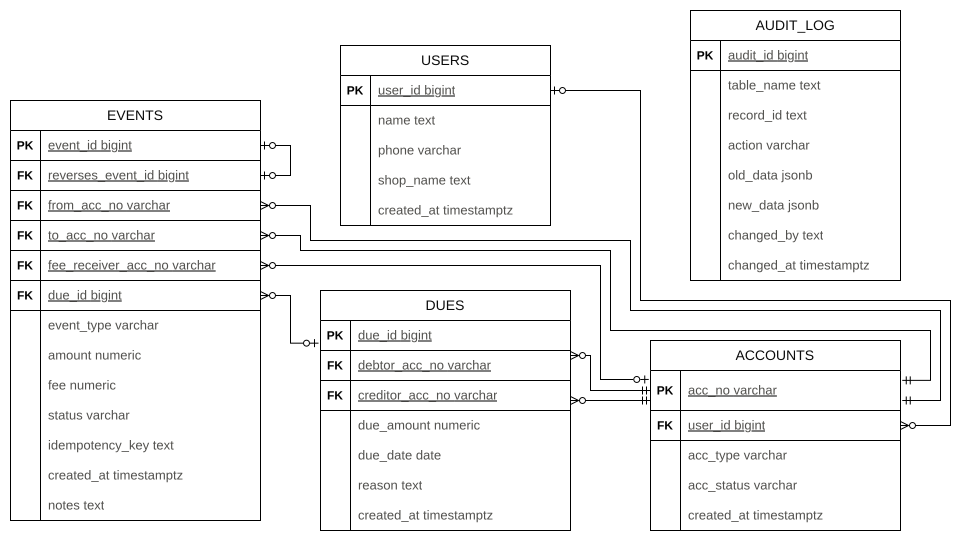

# SME Wallet & Baki (Credit) Ledger

A wallet and credit ("baki") system for small and medium businesses, built entirely in **raw PostgreSQL**: tables, constraints, functions, triggers and indexes. There is no ORM and no application code. All the business rules live in the database, so no client can break them.

Customers and merchants hold wallets and send each other money. A merchant can give a customer credit (a _baki_), and the customer pays it back in parts. Every movement of money is recorded as an immutable row in a ledger, and a balance is always calculated from that ledger instead of being stored.

## What this project demonstrates

| Topic                                              | Where it shows up                                             |
| -------------------------------------------------- | ------------------------------------------------------------- |
| Normalization (flat sheet to 3NF)                  | [Database design](#2-database-design)                         |
| Keys, constraints and enums                        | [Schema](#4-schema) and [Integrity rules](#6-integrity-rules) |
| Double-entry style ledger, no stored balance       | [How balances work](#7-how-balances-work)                     |
| Atomic transactions in PL/pgSQL                    | [Functions](#8-functions)                                     |
| Row locking and deadlock avoidance                 | [Concurrency and idempotency](#9-concurrency-and-idempotency) |
| Idempotent writes (safe retries)                   | [Concurrency and idempotency](#9-concurrency-and-idempotency) |
| Append-only tables and audit logging with triggers | [Triggers and audit log](#10-triggers-and-audit-log)          |
| Indexing with `EXPLAIN ANALYZE`                    | [Indexes](#11-indexes)                                        |
| Views, window functions, reconciliation checks     | [Reports](#12-reports)                                        |

## Contents

1. [Business model](#1-business-model)
2. [Database design](#2-database-design)
3. [Entity-relationship diagram](#3-entity-relationship-diagram)
4. [Schema](#4-schema)
5. [Relationships](#5-relationships)
6. [Integrity rules](#6-integrity-rules)
7. [How balances work](#7-how-balances-work)
8. [Functions](#8-functions)
9. [Concurrency and idempotency](#9-concurrency-and-idempotency)
10. [Triggers and audit log](#10-triggers-and-audit-log)
11. [Indexes](#11-indexes)
12. [Reports](#12-reports)
13. [Tests and demos](#13-tests-and-demos)
14. [Getting started](#14-getting-started)
15. [Limitations and design decisions](#15-limitations-and-design-decisions)
16. [Project files](#16-project-files)

---

## 1. Business model

**People and accounts**

- A **user** is a real person or a shop owner. A user can have one or more accounts.
- An **account** is a wallet. It has one of three types:
  - `customer`: an ordinary person.
  - `merchant`: a shop. Only a merchant can be owed a baki, and only a customer can owe one.
  - `system`: the single account that has **no owner**. Money enters the ledger from here (cash-in) and fees are collected here. Its balance is always negative, and all balances together always add up to exactly 0.
- An account is `active`, `frozen` or `closed`. Only `active` accounts can send or receive money.

**Money rules**

- Every payment and every due payment costs a **flat fee of 5**. The sender pays it on top of the amount, and it goes to the System account.
- A **baki** (due) is credit that a merchant gives a customer. Creating a due moves no money. The customer pays it back in parts (partial payments are allowed, never more than what remains). The merchant can forgive what is left (a write-off).
- A mistake is never edited. It is cancelled by a **reversal**: a new event that sends the amount back. The fee is kept.

**Event types**

Every action is one row in the `events` table.

| event_type    | Money moves from → to                       | Status     | Fee          | Linked to a due                        |
| ------------- | ------------------------------------------- | ---------- | ------------ | -------------------------------------- |
| `cash_in`     | System → user account                       | `success`  | 0            | no                                     |
| `payment`     | sender → receiver                           | `success`  | 5, to System | no                                     |
| `due_created` | creditor → debtor (a label, no money moves) | `recorded` | 0            | yes                                    |
| `due_payment` | debtor → creditor                           | `success`  | 5, to System | yes                                    |
| `write_off`   | creditor → debtor (a label, no money moves) | `recorded` | 0            | yes                                    |
| `reversal`    | original receiver → original sender         | `success`  | 0 (fee kept) | no, linked through `reverses_event_id` |

The **status** decides what counts as money: `success` moves money, `recorded` is only a note, and `pending` or `failed` are never counted.

---

## 2. Database design

The design started from one big "flat sheet" and was normalized step by step.

### 2.1 The flat sheet

The starting point is a single table with one row per event, holding everything about that event: both accounts, both account owners, the due and the money.

Columns of the flat sheet:

| Group                           | Columns                                                                                                                  |
| ------------------------------- | ------------------------------------------------------------------------------------------------------------------------ |
| Event                           | `event_id`, `event_type`, `reverses_event_id`, `amount`, `fee`, `status`, `idempotency_key`, `notes`, `created_at`       |
| Sending account and its owner   | `from_acc_no`, `from_acc_type`, `from_acc_status`, `from_user_id`, `from_user_name`, `from_user_phone`, `from_shop_name` |
| Receiving account and its owner | `to_acc_no`, `to_acc_type`, `to_acc_status`, `to_user_id`, `to_user_name`, `to_user_phone`, `to_shop_name`               |
| Fee receiver                    | `fee_receiver_acc_no`                                                                                                    |
| Due                             | `due_id`, `debtor_acc_no`, `creditor_acc_no`, `due_amount`, `due_date`, `due_reason`, `due_created_at`                   |

A few rows of the flat sheet (some columns left out so it fits):

| event_id | event_type  | from_acc_no | from_user_name | from_user_phone | to_acc_no | to_user_name | to_user_phone | to_shop_name | due_id | due_amount | due_date   | amount  | fee  |
| -------- | ----------- | ----------- | -------------- | --------------- | --------- | ------------ | ------------- | ------------ | ------ | ---------- | ---------- | ------- | ---- |
| 1        | cash_in     | ACC-000     | NULL           | NULL            | ACC-001   | Karim        | 01111111111   | NULL         | NULL   | NULL       | NULL       | 1000.00 | 0.00 |
| 2        | payment     | ACC-001     | Karim          | 01111111111     | ACC-002   | Rahim        | 01111111112   | Rahim Store  | NULL   | NULL       | NULL       | 100.00  | 5.00 |
| 3        | due_created | ACC-002     | Rahim          | 01111111112     | ACC-001   | Karim        | 01111111111   | NULL         | 1      | 300.00     | 2026-11-07 | 300.00  | 0.00 |
| 4        | due_payment | ACC-001     | Karim          | 01111111111     | ACC-002   | Rahim        | 01111111112   | Rahim Store  | 1      | 300.00     | 2026-11-07 | 100.00  | 5.00 |

### 2.2 What is wrong with the flat sheet

- **Redundancy.** Karim's name and phone are copied into every row he appears in. The due's amount and date are copied into every event of that due.
- **Update anomaly.** If Karim changes his phone number, every row must be updated. Miss one and the database holds two phone numbers for one person.
- **Insert anomaly.** A user or an account cannot exist until some event mentions it. A due cannot be recorded without an event row.
- **Delete anomaly.** Deleting the only event of an account also deletes the fact that the account (and its owner) exists.

### 2.3 First normal form (1NF)

_Rule: every cell holds one atomic value, there are no repeating groups, and every row is unique and identified by a primary key._

The flat sheet already satisfies 1NF:

- Every cell holds a single value: one phone number, one account number, one amount.
- There are no repeating groups. One row is one event, and there are no lists inside a cell.
- The primary key is `event_id`.

No change is needed at this step.

### 2.4 Second normal form (2NF)

_Rule: the table is in 1NF, and every non-key column depends on the whole primary key, not on only a part of it._

A partial dependency can only exist when the key has more than one column. The key here is the single column `event_id`, so there is nothing to split off. The flat sheet already satisfies 2NF.

No change is needed at this step either.

### 2.5 Third normal form (3NF)

_Rule: the table is in 2NF, and no non-key column depends on another non-key column (no transitive dependency). Every non-key column depends on "the key, the whole key, and nothing but the key"._

The flat sheet breaks this rule. These are the functional dependencies found in it:

| Determinant (not the key)                         | Determines                                                                           |
| ------------------------------------------------- | ------------------------------------------------------------------------------------ |
| `from_acc_no`, `to_acc_no`, `fee_receiver_acc_no` | account type, account status and the owner `user_id`                                 |
| `user_id`                                         | `name`, `phone`, `shop_name`                                                         |
| `due_id`                                          | `debtor_acc_no`, `creditor_acc_no`, `due_amount`, `due_date`, `reason`, `created_at` |

So `event_id → from_acc_no → from_user_id → from_user_name`: the user's name depends on the event only _through_ the account and the user. That is a transitive dependency.

**Decomposition**

1. Move the user columns into **`users`**, keyed by `user_id`.
2. Move the account columns into **`accounts`**, keyed by `acc_no`. The sending account, the receiving account, the fee receiver, the debtor and the creditor are all just _roles_ of the same entity. One `accounts` table serves all of them. The role becomes a foreign-key column in the table that refers to it (`from_acc_no`, `to_acc_no`, `fee_receiver_acc_no`, `debtor_acc_no`, `creditor_acc_no`).
3. Move the due columns into **`dues`**, keyed by `due_id`.
4. What is left is **`events`**, keyed by `event_id`.
5. **`audit_log`** is not a result of decomposition. It is a system table that records changes (see [section 10](#10-triggers-and-audit-log)).

**Where every flat-sheet column went**

| Flat-sheet column                                                                                                                                                               | Now lives in                                     |
| ------------------------------------------------------------------------------------------------------------------------------------------------------------------------------- | ------------------------------------------------ |
| `from_user_name`, `from_user_phone`, `from_shop_name`, `to_user_name`, `to_user_phone`, `to_shop_name`                                                                          | `users` (`name`, `phone`, `shop_name`)           |
| `from_user_id`, `to_user_id`, `from_acc_type`, `from_acc_status`, `to_acc_type`, `to_acc_status`                                                                                | `accounts` (`user_id`, `acc_type`, `acc_status`) |
| `debtor_acc_no`, `creditor_acc_no`, `due_amount`, `due_date`, `due_reason`, `due_created_at`                                                                                    | `dues`                                           |
| `event_id`, `event_type`, `reverses_event_id`, `from_acc_no`, `to_acc_no`, `due_id`, `amount`, `fee`, `fee_receiver_acc_no`, `status`, `idempotency_key`, `notes`, `created_at` | `events`                                         |

**3NF check of the result**

| Table       | Primary key | Every other column depends on                                            |
| ----------- | ----------- | ------------------------------------------------------------------------ |
| `users`     | `user_id`   | `user_id` only (`phone` is also unique, so it is a second candidate key) |
| `accounts`  | `acc_no`    | `acc_no` only                                                            |
| `dues`      | `due_id`    | `due_id` only                                                            |
| `events`    | `event_id`  | `event_id` only (`idempotency_key` is also unique)                       |
| `audit_log` | `audit_id`  | `audit_id` only                                                          |

In each table every determinant is a candidate key, so the tables are in Boyce-Codd normal form (BCNF) as well.

### 2.6 Data that is deliberately not stored

Storing a value that can be calculated creates a copy that can drift away from the truth, which is the same anomaly normalization removes. So two values are calculated, never stored:

- **An account's balance.** It is calculated from the `events` table ([section 7](#7-how-balances-work)).
- **The remaining amount of a due.** It is calculated from `dues` and `events` (`get_due_remaining`).

The `fee` _is_ stored on each event, on purpose. The fee is a fact about that event. If the fee rule changes later, old events must keep the fee they were actually charged.

---

## 3. Entity-relationship diagram



The diagram shows the five tables and their columns. Every foreign key is described in [section 5](#5-relationships), and `audit_log` has no relationships on purpose. The exact column types and every constraint are in the next sections.

---

## 4. Schema

The full, runnable definition is in [`ledger.sql`](ledger.sql). This section describes it.

### Enum types

| Type           | Values                                                                      |
| -------------- | --------------------------------------------------------------------------- |
| `acc_type`     | `system`, `customer`, `merchant`                                            |
| `acc_status`   | `active`, `frozen`, `closed`                                                |
| `event_type`   | `cash_in`, `payment`, `due_created`, `due_payment`, `reversal`, `write_off` |
| `event_status` | `pending`, `success`, `failed`, `recorded`                                  |
| `action_type`  | `INSERT`, `UPDATE`, `DELETE`                                                |

### `users`

One row per real person or shop owner.

| Column       | Type          | Null | Default  | Notes                                            |
| ------------ | ------------- | ---- | -------- | ------------------------------------------------ |
| `user_id`    | `BIGINT`      | no   | identity | Primary key, auto-generated (`GENERATED ALWAYS`) |
| `name`       | `TEXT`        | no   |          |                                                  |
| `phone`      | `VARCHAR(15)` | no   |          | `UNIQUE`                                         |
| `shop_name`  | `VARCHAR(50)` | yes  |          | `NULL` for plain customers                       |
| `created_at` | `TIMESTAMPTZ` | no   | `NOW()`  |                                                  |

### `accounts`

A wallet. Owned by a user, except the System account.

| Column       | Type          | Null | Default      | Notes                                                      |
| ------------ | ------------- | ---- | ------------ | ---------------------------------------------------------- |
| `acc_no`     | `VARCHAR(20)` | no   |              | Primary key (natural key, for example a wallet number)     |
| `user_id`    | `BIGINT`      | yes  |              | Foreign key to `users`. `NULL` only for the System account |
| `acc_type`   | `acc_type`    | no   | `'customer'` |                                                            |
| `acc_status` | `acc_status`  | no   | `'active'`   |                                                            |
| `created_at` | `TIMESTAMPTZ` | no   | `NOW()`      |                                                            |

### `dues`

One row is one credit agreement: the debtor owes the creditor an amount.

| Column            | Type            | Null | Default  | Notes                                               |
| ----------------- | --------------- | ---- | -------- | --------------------------------------------------- |
| `due_id`          | `BIGINT`        | no   | identity | Primary key                                         |
| `debtor_acc_no`   | `VARCHAR(20)`   | no   |          | Foreign key to `accounts`: who owes (a customer)    |
| `creditor_acc_no` | `VARCHAR(20)`   | no   |          | Foreign key to `accounts`: who is owed (a merchant) |
| `due_amount`      | `NUMERIC(12,2)` | no   |          | Must be greater than 0                              |
| `due_date`        | `DATE`          | no   |          | Payment deadline                                    |
| `reason`          | `TEXT`          | yes  |          | Optional note                                       |
| `created_at`      | `TIMESTAMPTZ`   | no   | `NOW()`  |                                                     |

### `events`

The ledger. Every money movement and every due action is one row. The table is append-only.

| Column                | Type            | Null | Default  | Notes                                                 |
| --------------------- | --------------- | ---- | -------- | ----------------------------------------------------- |
| `event_id`            | `BIGINT`        | no   | identity | Primary key                                           |
| `event_type`          | `event_type`    | no   |          |                                                       |
| `reverses_event_id`   | `BIGINT`        | yes  |          | Foreign key to `events`. Filled only for reversals    |
| `from_acc_no`         | `VARCHAR(20)`   | no   |          | Foreign key to `accounts`                             |
| `to_acc_no`           | `VARCHAR(20)`   | no   |          | Foreign key to `accounts`                             |
| `due_id`              | `BIGINT`        | yes  |          | Foreign key to `dues`. Filled only for due events     |
| `amount`              | `NUMERIC(12,2)` | no   |          | Must be greater than 0                                |
| `fee`                 | `NUMERIC(12,2)` | no   | `0`      | Must be 0 or more                                     |
| `fee_receiver_acc_no` | `VARCHAR(20)`   | yes  |          | Foreign key to `accounts`. Filled only when `fee > 0` |
| `status`              | `event_status`  | no   |          |                                                       |
| `idempotency_key`     | `TEXT`          | yes  |          | `UNIQUE`. Retry protection                            |
| `notes`               | `TEXT`          | yes  |          |                                                       |
| `created_at`          | `TIMESTAMPTZ`   | no   | `NOW()`  |                                                       |

### `audit_log`

One row per change on a tracked table, written by triggers. It is append-only.

| Column       | Type          | Null | Default        | Notes                                        |
| ------------ | ------------- | ---- | -------------- | -------------------------------------------- |
| `audit_id`   | `BIGINT`      | no   | identity       | Primary key                                  |
| `table_name` | `TEXT`        | no   |                | Which table changed                          |
| `record_id`  | `TEXT`        | no   |                | Primary key of the changed row, as text      |
| `action`     | `action_type` | no   |                |                                              |
| `old_data`   | `JSONB`       | yes  |                | Row before the change (`NULL` for an INSERT) |
| `new_data`   | `JSONB`       | yes  |                | Row after the change (`NULL` for a DELETE)   |
| `changed_by` | `TEXT`        | no   | `CURRENT_USER` |                                              |
| `changed_at` | `TIMESTAMPTZ` | no   | `NOW()`        |                                              |

---

## 5. Relationships

Every relationship is a foreign key. By default PostgreSQL refuses to delete a parent row that still has children, which is what a ledger needs.

| Child column                 | Parent            | Meaning                                                                                              | Optional?                               |
| ---------------------------- | ----------------- | ---------------------------------------------------------------------------------------------------- | --------------------------------------- |
| `accounts.user_id`           | `users.user_id`   | A user has zero or more accounts. An account has one owner.                                          | Yes: `NULL` only for the System account |
| `dues.debtor_acc_no`         | `accounts.acc_no` | A due has exactly one debtor account. An account can be the debtor of many dues.                     | No                                      |
| `dues.creditor_acc_no`       | `accounts.acc_no` | A due has exactly one creditor account. An account can be the creditor of many dues.                 | No                                      |
| `events.from_acc_no`         | `accounts.acc_no` | An event has exactly one sending account.                                                            | No                                      |
| `events.to_acc_no`           | `accounts.acc_no` | An event has exactly one receiving account.                                                          | No                                      |
| `events.fee_receiver_acc_no` | `accounts.acc_no` | An event with a fee has one fee receiver.                                                            | Yes: `NULL` when the fee is 0           |
| `events.due_id`              | `dues.due_id`     | A due has many events (created, payments, write-off). An event belongs to at most one due.           | Yes: only due events have one           |
| `events.reverses_event_id`   | `events.event_id` | A reversal points to the event it cancels (a self-reference). An event can be reversed at most once. | Yes: only reversals have one            |

`audit_log` has **no foreign keys**, on purpose. It must keep its history even if the row it describes is gone, and one table records changes from four different tables (`record_id` is plain text).

**Cardinality summary**

- `users` 1 : 0..N `accounts`
- `accounts` 1 : 0..N `dues` (as debtor), and 1 : 0..N `dues` (as creditor)
- `accounts` 1 : 0..N `events` (as sender), 1 : 0..N `events` (as receiver), and 1 : 0..N `events` (as fee receiver)
- `dues` 1 : 0..N `events`
- `events` 1 : 0..1 `events` (a reversal)

---

## 6. Integrity rules

These rules are enforced by the database itself, so they hold no matter which program connects.

| Constraint                    | Table      | Rule                                                                                      |
| ----------------------------- | ---------- | ----------------------------------------------------------------------------------------- |
| `accounts_owner_rule`         | `accounts` | The `system` account has no owner. Every other account must have one.                     |
| `dues_debtor_not_creditor`    | `dues`     | Nobody can owe themselves.                                                                |
| `events_from_not_to`          | `events`   | Money cannot go from an account to itself.                                                |
| `events_reversal_rule`        | `events`   | `reverses_event_id` is filled exactly when the event is a `reversal`.                     |
| `events_fee_receiver_rule`    | `events`   | A fee needs a receiver, and no fee means no receiver.                                     |
| `events_due_rule`             | `events`   | `due_id` is filled exactly when the event is `due_created`, `due_payment` or `write_off`. |
| `CHECK (amount > 0)`          | `events`   | Amounts are positive.                                                                     |
| `CHECK (fee >= 0)`            | `events`   | Fees are never negative.                                                                  |
| `CHECK (due_amount > 0)`      | `dues`     | A due is a positive amount.                                                               |
| `UNIQUE (phone)`              | `users`    | One phone number per user.                                                                |
| `UNIQUE (idempotency_key)`    | `events`   | A key can be used once. Many rows can have `NULL`.                                        |
| `uq_events_reverses_event_id` | `events`   | An event can be reversed at most once (a unique index).                                   |

The functions in [section 8](#8-functions) add the rules that need data from other rows, such as "the sender must have enough balance".

---

## 7. How balances work

There is **no balance column**. A balance is calculated from the successful events that touch the account:

> balance = money received − (money sent + fees paid) + fees earned

```sql
SELECT
    COALESCE(SUM(amount)         FILTER (WHERE to_acc_no           = p_acc_no), 0)
    - COALESCE(SUM(amount + fee) FILTER (WHERE from_acc_no         = p_acc_no), 0)
    + COALESCE(SUM(fee)          FILTER (WHERE fee_receiver_acc_no = p_acc_no), 0)
FROM events
WHERE status = 'success'
  AND (to_acc_no = p_acc_no OR from_acc_no = p_acc_no OR fee_receiver_acc_no = p_acc_no);
```

This is wrapped in the function `get_balance(acc_no)`.

**Worked example**

| Step                   | Event                                    | ACC-001 (Karim) | ACC-002 (Rahim) | ACC-000 (System) |
| ---------------------- | ---------------------------------------- | --------------- | --------------- | ---------------- |
| 1                      | `cash_in` 1000 to Karim                  | +1000           |                 | −1000            |
| 2                      | `payment` 100 from Karim to Rahim, fee 5 | −105            | +100            | +5               |
| **Balance after both** |                                          | **895**         | **100**         | **−995**         |

The three balances add up to 0. This is the main check of the whole ledger: **the sum of all balances is always exactly 0**, because every event takes an amount from one account and gives the same amount to others. The System account is negative by design. It is where money enters.

**The remaining amount of a due** is calculated in the same way (`get_due_remaining`):

> remaining = due_amount − successful due payments − write-offs + reversed due payments

Only the `amount` of a due payment reduces the due. The fee is a service charge.

---

## 8. Functions

Every write function runs as **one transaction**: if anything fails halfway, everything it did is rolled back. Every write function takes an `idempotency_key`, so a retry returns the original result instead of repeating the action.

| Function                                                                                            | Returns   | What it does                                            | Locks taken                                     |
| --------------------------------------------------------------------------------------------------- | --------- | ------------------------------------------------------- | ----------------------------------------------- |
| `get_balance(p_acc_no)`                                                                             | `NUMERIC` | Balance of one account                                  | none                                            |
| `get_due_remaining(p_due_id)`                                                                       | `NUMERIC` | What is still unpaid on a due                           | none                                            |
| `cash_in(p_to_acc_no, p_amount, p_idempotency_key)`                                                 | event id  | System sends money to a user account                    | none (System may go negative)                   |
| `payment(p_from_acc_no, p_to_acc_no, p_amount, p_idempotency_key)`                                  | event id  | Transfer between two accounts, fee 5 paid by the sender | both accounts                                   |
| `create_due(p_debtor_acc_no, p_creditor_acc_no, p_amount, p_due_date, p_reason, p_idempotency_key)` | due id    | Records a baki. Moves no money                          | none                                            |
| `pay_due(p_due_id, p_amount, p_idempotency_key)`                                                    | event id  | Debtor pays all or part of a due, fee 5                 | the due, then both accounts                     |
| `write_off(p_due_id, p_reason, p_idempotency_key)`                                                  | event id  | Creditor forgives what is left. Moves no money          | the due                                         |
| `reverse_event(p_event_id, p_reason, p_idempotency_key)`                                            | event id  | Cancels a payment or due payment, the fee is kept       | the due (due payments only), then both accounts |

**What each function checks**

- **All write functions:** a repeated idempotency key returns the original event and changes nothing.
- **`cash_in`:** the amount is positive, the destination account exists and is `active`, and it is not the System account.
- **`payment`:** the amount is positive. Sender and receiver are different, both exist and are `active`, and neither is the System account. The sender can afford `amount + fee`.
- **`create_due`:** the amount is positive and the due date is today or later. Both accounts exist and are `active`. The debtor is a `customer` and the creditor is a `merchant`.
- **`pay_due`:** the amount is positive and the due exists and is not settled. The payment is not more than what remains, both accounts are `active`, and the debtor can afford `amount + fee`. Who pays whom comes from the `dues` row, so a caller cannot send the money to the wrong account.
- **`write_off`:** the due exists and there is something left to forgive. The written-off amount is calculated by the function, never given by the caller.
- **`reverse_event`:**
  - Only a successful `payment` or `due_payment` can be reversed.
  - An event can be reversed once, and a reversal cannot be reversed.
  - Both accounts are `active`, and the receiver still has the money.
  - A due payment cannot be reversed after its due was written off.

**Example**

```sql
SELECT cash_in('ACC-001', 1000, 'ci-1');
SELECT payment('ACC-001', 'ACC-002', 100, 'p-1');

SELECT create_due('ACC-001', 'ACC-002', 300, CURRENT_DATE + 30, 'groceries', 'due-1') AS due_id \gset
SELECT pay_due(:due_id, 100, 'pd-1');
SELECT get_due_remaining(:due_id);

SELECT * FROM v_account_balances;
```

(`\gset` is a `psql` command that stores the result in a variable.)

---

## 9. Concurrency and idempotency

### The problem: two payments at the same moment

Karim has 500. Two payments of 400 arrive together (fees are left out here to keep the numbers simple). A naive function reads the balance (500 is enough) and then inserts. Both requests read the balance before either one inserts, so both pass and Karim ends at −300. Putting the code in a transaction does not help, because neither transaction can see the other's uncommitted payment.

### The fix: lock the row first

`payment()` runs `SELECT ... FOR UPDATE` on both accounts **before** it reads the balance. The second request waits for the first to commit, then reads the balance again and sees the real value (100), so it is refused.

The order inside every spending function is always: **lock, read, check, write.**

### Avoiding deadlocks: one lock order

If A pays B at the same moment B pays A, each could lock its own account and wait forever for the other. Every function therefore takes its locks in the same fixed order:

1. the **due** row first (if the function involves a due),
2. then the **accounts**, sorted by `acc_no`.

Because every function follows the same order, a cycle of waiting can never form.

`pay_due` and `write_off` lock the `dues` row, so two payments cannot overpay one baki, and a payment and a write-off cannot both act on the same remaining amount.

### Idempotency

A client that does not get a reply (a dropped connection, a double tap) will send the request again. Each write function takes an `idempotency_key`. If an event with that key already exists, the function returns that event's id and changes nothing. The key is protected by a `UNIQUE` constraint.

### Measured result

The two-window demo in `ledger.sql` (section 8.1) was run on PostgreSQL 16 with an account holding 200 and two payments of 150:

| Version               | What happened                                                                                               | Account balance after |
| --------------------- | ----------------------------------------------------------------------------------------------------------- | --------------------- |
| With `FOR UPDATE`     | The second payment waited about 3 seconds, then failed with `Insufficient balance: need 155.00, have 45.00` | 45.00                 |
| With the lock removed | Both payments succeeded                                                                                     | −110.00               |

---

## 10. Triggers and audit log

A trigger is a function that PostgreSQL runs automatically when a row changes.

| Trigger                                                                       | On                                         | Does                                                                       |
| ----------------------------------------------------------------------------- | ------------------------------------------ | -------------------------------------------------------------------------- |
| `trg_events_append_only`                                                      | `events`, before UPDATE or DELETE          | Raises an error: the ledger is never edited                                |
| `trg_audit_log_append_only`                                                   | `audit_log`, before UPDATE or DELETE       | Raises an error: history is never edited                                   |
| `trg_events_no_truncate`                                                      | `events`, before TRUNCATE                  | Raises an error                                                            |
| `trg_audit_log_no_truncate`                                                   | `audit_log`, before TRUNCATE               | Raises an error                                                            |
| `trg_users_audit`, `trg_accounts_audit`, `trg_dues_audit`, `trg_events_audit` | each table, after INSERT, UPDATE or DELETE | Writes one `audit_log` row with the old and new version of the row as JSON |

Because `events` cannot be edited, a mistake is corrected with `reverse_event()`, which adds a new event and leaves history intact.

---

## 11. Indexes

Primary keys and `UNIQUE` constraints already have an index. These cover the real query patterns.

| Index                                  | On                                                                     | Used by                            |
| -------------------------------------- | ---------------------------------------------------------------------- | ---------------------------------- |
| `idx_events_from_acc`                  | `events (from_acc_no)` where `status = 'success'`                      | `get_balance`, statements          |
| `idx_events_to_acc`                    | `events (to_acc_no)` where `status = 'success'`                        | `get_balance`, statements          |
| `idx_events_fee_receiver`              | `events (fee_receiver_acc_no)` where `status = 'success'` and not null | `get_balance`, statements          |
| `idx_events_due_id`                    | `events (due_id)` where not null                                       | `get_due_remaining`, due history   |
| `uq_events_reverses_event_id`          | `events (reverses_event_id)`, unique                                   | One reversal per event             |
| `idx_dues_debtor`, `idx_dues_creditor` | `dues`                                                                 | All dues of a customer or merchant |
| `idx_dues_due_date`                    | `dues (due_date)`                                                      | The overdue report                 |
| `idx_accounts_user_id`                 | `accounts (user_id)`                                                   | All accounts of a user             |
| `idx_audit_log_record`                 | `audit_log (table_name, record_id)`                                    | Reading the history of one row     |

The partial indexes (`WHERE ...`) hold only the rows a query can use, which keeps them small.

**Benchmark.** Section 8.2 of `ledger.sql` creates 2,000 accounts and 200,000 events inside a transaction, times the balance query for one account with `EXPLAIN ANALYZE`, and then rolls everything back. On PostgreSQL 16 in a test environment:

| Plan                                                    | Execution time |
| ------------------------------------------------------- | -------------- |
| Indexes switched off (sequential scan of 200,000 rows)  | about 16.9 ms  |
| Indexes on (bitmap scan over the three account indexes) | about 0.2 ms   |

Your numbers will differ with your hardware, but the gap between the two plans is the point.

---

## 12. Reports

| Name                                   | Kind     | What it shows                                                                                     |
| -------------------------------------- | -------- | ------------------------------------------------------------------------------------------------- |
| `v_account_balances`                   | view     | Every account with its owner and current balance                                                  |
| `v_due_summary`                        | view     | Every due with debtor, creditor, remaining amount and state (`open`, `overdue` or `settled`)      |
| `v_overdue_dues`                       | view     | Unpaid dues past their deadline, with days overdue                                                |
| `get_statement(acc_no, limit, offset)` | function | An account statement, newest first, with the running balance after each event (a window function) |
| `check_ledger_integrity()`             | function | Reconciliation checks. Every row must show `passed = true`                                        |

`check_ledger_integrity()` verifies that:

1. all balances add up to zero,
2. no customer or merchant account is negative,
3. no due is overpaid,
4. every due has exactly one `due_created` event,
5. every reversal is the exact mirror of its original event.

---

## 13. Tests and demos

`ledger.sql` ends with two sections that run as part of the file.

**7. Tests.** 82 checks on PostgreSQL 16, each printing a `PASS` notice. They cover every table rule, every function (the normal case, the idempotent retry and each refused input), reversals, the append-only triggers, the audit log and the final reconciliation. Cases that must fail are caught inside the test, so the file runs from top to bottom. A wrong result raises an exception and stops the file.

**8. Demos.**

- **8.1** The two-window concurrency demo (instructions inside the file).
- **8.2** The index benchmark, which ends with `ROLLBACK` so it keeps no data.

The tests leave sample accounts, events and dues in the database. To start clean, run the `RESET` block at the top of the file.

---

## 14. Getting started

**Requirements:** PostgreSQL 11 or newer (developed and tested on 16) and the `psql` client.

```bash
# 1. Create an empty database
createdb ledger

# 2. Run the whole file (schema, seed data, functions, triggers, indexes, reports, tests, demos)
psql -d ledger -v ON_ERROR_STOP=1 -f ledger.sql
```

To start over, uncomment the two `RESET` lines at the top of `ledger.sql` (`DROP SCHEMA public CASCADE; CREATE SCHEMA public;`) and run it again. This deletes everything in the `public` schema.

**Seed data**

| acc_no    | Owner               | Type       |
| --------- | ------------------- | ---------- |
| `ACC-000` | none                | `system`   |
| `ACC-001` | Karim               | `customer` |
| `ACC-002` | Rahim (Rahim Store) | `merchant` |
| `ACC-003` | Sakib               | `customer` |
| `ACC-004` | Arif (Arif Store)   | `merchant` |
| `ACC-005` | Kabir               | `customer` |

---

## 15. Limitations and design decisions

- **No authorization in the database.** The functions guarantee consistent data, but who is _allowed_ to call `write_off` (only the merchant who owns the due) or `reverse_event` belongs in an application layer.
- **Append-only is enforced by triggers.** A database owner or superuser can still disable a trigger. For real protection, the application should connect with a role that has only `INSERT` and `SELECT` on `events` and `audit_log`.
- **The fee is a constant.** The flat fee of 5 is written into `payment` and `pay_due`. A configuration table would be the next step if fees had to change.
- **Balances are calculated on every call.** With the indexes this is fast, but the cost grows with an account's history. At a much larger scale, a periodic balance snapshot would be added.
- **One currency.** There is no currency column.
- **The idempotency key is not compared with the request.** Reusing a key with a different amount returns the original event instead of an error. Two requests with the same key at the exact same instant could make the second one fail on the `UNIQUE` constraint instead of returning the first result.
- **Dues are simple.** There is no interest, penalty or instalment schedule. A due has no status column, because its state is derived.
- **Accounts are closed, not deleted.** Foreign keys refuse deleting an account or user that has history. Changing an account's status is a plain `UPDATE`, which is recorded in the audit log.
- **`pending` is reserved.** The status exists for future asynchronous flows, but no function creates a `pending` event yet.

---

## 16. Project files

| File         | Contents                                                                                        |
| ------------ | ----------------------------------------------------------------------------------------------- |
| `README.md`  | This document                                                                                   |
| `erd.svg`    | The entity-relationship diagram (drawn in draw.io)                                              |
| `erd.drawio` | The editable source file of the entity-relationship diagram                                     |
| `ledger.sql` | The complete project: schema, seed data, functions, triggers, indexes, reports, tests and demos |

**Author:** Md Ismile Hosen Siam
